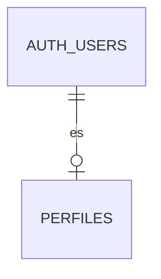

# Base de datos

Supabase (Postgres 17 + PostGIS). Las migraciones están en `supabase/migrations/`. Los tipos de TypeScript se generan con `npm run db:tipos`.

## Estado actual (Fase 0)

| Migración                        | Qué hace                                                                                                           |
| -------------------------------- | ------------------------------------------------------------------------------------------------------------------ |
| `20261022000000_extensiones.sql` | Instala `postgis` y `pgcrypto` en el esquema `extensions` y quita el permiso de crear objetos en `public` a todos. |

Las tablas llegan desde la Fase 1. Este documento se actualiza con cada migración, con el diagrama completo.

## Convenciones

- Tablas y columnas en español, sin tildes ni ñ.
- Geometrías en SRID 4326; índices GiST.
- RLS activo en todas las tablas, con pruebas por rol.
- Funciones `security definer` con `set search_path = ''` y nombres totalmente calificados.
